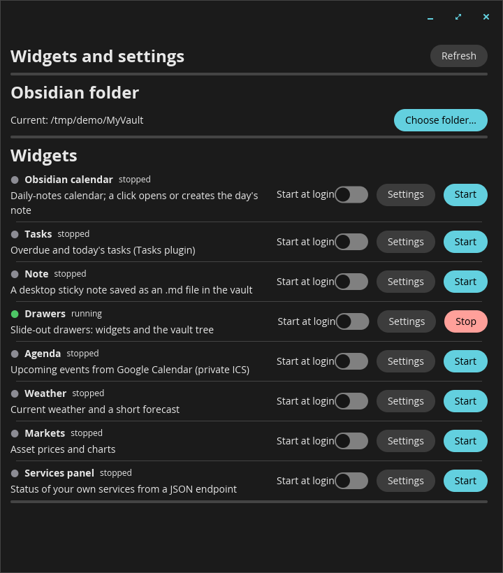
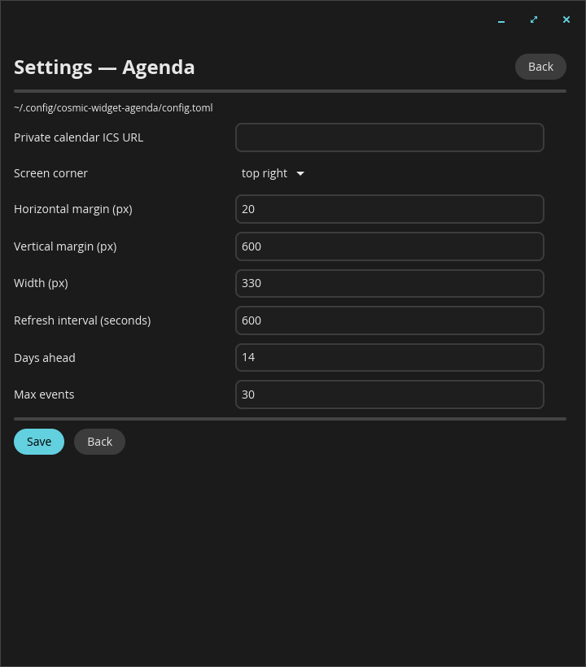

# cosmic-widgets-manager

🇵🇱 [Wersja polska](README.pl.md)





A small GUI for the widgets in this repo — no more editing TOML by hand.

- List of all widgets with **Start / Stop** and an **Autostart** toggle (writes `~/.config/autostart/<widget>.desktop`).
- **Obsidian vault picker**: choose your vault folder once (system file chooser via XDG portal). The folder is validated (`.obsidian/` must exist) and `vault_path` / `vault_name` are written into the configs of every vault-based widget (calendar, tasks, note, drawer). Comments and other keys in those files are kept.
- **Settings form** per widget (corner, margins, width, refresh interval, ICS URL, coordinates, API URL/key …). Defaults come from each widget's `config.rs`; saving keeps comments and other keys. After saving, press **Restart** to apply.
- Interface in English or Polish, chosen from `LC_ALL` / `LC_MESSAGES` / `LANG` (`pl*` = Polish, anything else = English).
- Widgets are looked up in `~/.local/bin`, then in `PATH`.

## Build

```sh
cd cosmic-widgets-manager
cargo build --release
cp target/release/cosmic-widgets-manager ~/.local/bin/
```

Restart running widgets after changing the vault so they pick up the new path.

Status: early version (v0.2). The UI is bilingual (English / Polish).

## Install without Rust

Download the `.tar.gz` or `.deb` from [Releases](https://github.com/longer54/pop-os-cosmic-widgets/releases). Requires COSMIC (cosmic-comp ≥ 1.0). Flatpak is not provided: the sandbox gets in the way of launching the widget processes and of reaching your vault.
