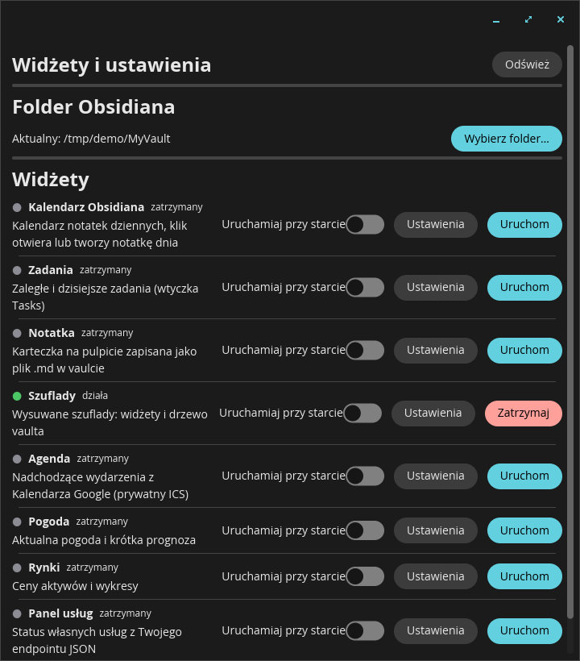
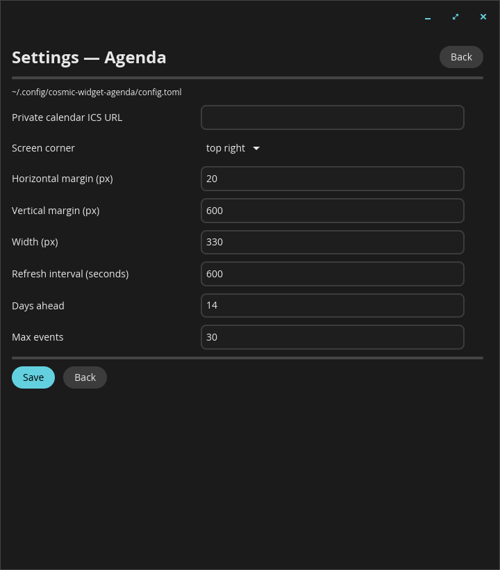

# cosmic-widgets-manager

🇬🇧 [English version](README.md)





Mała aplikacja z oknem do widżetów z tego repo — koniec z ręczną edycją TOML.

- Lista wszystkich widżetów z **Uruchom / Zatrzymaj**, wskaźnikiem stanu (działa / zatrzymany / nie zainstalowany) i przełącznikiem **Uruchamiaj przy starcie** (zapisuje `~/.config/autostart/<widżet>.desktop`).
- **Wybór folderu Obsidiana**: wskazujesz raz folder sejfu (systemowe okno wyboru przez XDG portal). Folder jest sprawdzany (musi mieć `.obsidian/`), a `vault_path` / `vault_name` trafiają do configów wszystkich widżetów opartych o vault (kalendarz, zadania, notatka, szuflady). Komentarze i pozostałe klucze w tych plikach zostają.
- **Formularz ustawień** przy każdym widżecie (róg ekranu, odstępy, szerokość, odświeżanie, adres ICS, współrzędne, adres i klucz API …). Wartości domyślne pochodzą z `config.rs` widżetu; zapis zachowuje komentarze i inne klucze. Po zapisie naciśnij **Restart**, żeby zmiany zadziałały.
- Interfejs po polsku lub angielsku zależnie od `LC_ALL` / `LC_MESSAGES` / `LANG` (`pl*` = polski, reszta = angielski).
- Widżety są szukane w `~/.local/bin`, potem w `PATH`.

## Budowanie

```sh
cd cosmic-widgets-manager
cargo build --release
cp target/release/cosmic-widgets-manager ~/.local/bin/
```

## Instalacja bez Rusta

Pobierz `.tar.gz` albo `.deb` z [Releases](https://github.com/longer54/pop-os-cosmic-widgets/releases). Wymaga COSMIC (cosmic-comp ≥ 1.0). Flatpaka nie ma: piaskownica utrudnia uruchamianie procesów widżetów i dostęp do sejfu Obsidiana.

Status: wczesna wersja (v0.2). Interfejs dwujęzyczny (polski / angielski).
